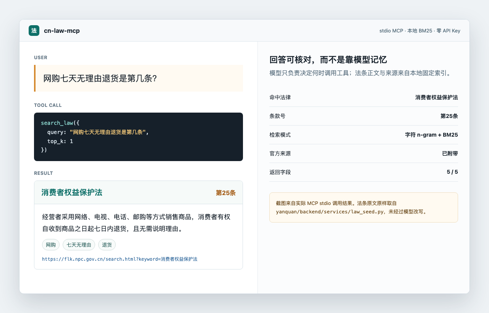

# cn-law-mcp

让 Claude、Cursor、Cherry Studio 通过 MCP 检索中国法条。零 API key 可用，每条结果都带国家法律法规数据库的官方检索链接。

相关仓库：[言权产品](https://github.com/2598389291-beep/yanquan) · [法条检索评测中台](https://github.com/2598389291-beep/yanquan-retrieval)



## 15 秒开始

先自检：

```bash
uvx --from git+https://github.com/2598389291-beep/cn-law-mcp cn-law-mcp --selftest
# 108 条法条索引加载成功
```

把下面配置加入 MCP 客户端：

```json
{
  "mcpServers": {
    "cn-law-mcp": {
      "command": "uvx",
      "args": [
        "--from",
        "git+https://github.com/2598389291-beep/cn-law-mcp",
        "cn-law-mcp"
      ]
    }
  }
}
```

然后直接问：

> 网购七天无理由退货是第几条？

预期返回《消费者权益保护法》第 25 条、条文原文、关键词和 `flk.npc.gov.cn` 官方检索链接。

## 提供的三个工具

| 工具 | 适用时机 | 返回 |
| --- | --- | --- |
| `search_law(query, top_k=5)` | 已知问题，但不知道对应哪条法律 | `法律名 / 条款号 / 原文 / 关键词 / 官方链接` |
| `get_article(law_name, article_no)` | 已知准确法律名和条号 | 一条法条；不存在时返回明确提示 |
| `cite_check(text)` | 模型准备引用法条，或需要验证一段文字 | 逐条返回 `verified / not_found / unverifiable` |

工具参数和输出字段都带中文 schema 描述，模型可以根据“查法条、精确取条、核验引用”三种意图自行选择。

所有可预期错误统一为：

```json
{
  "error": "未找到《消费者权益保护法》第999条",
  "hint": "请先用 search_law 确认法律名和条款号；本地索引只覆盖 108 条法条"
}
```

## 安装

用 `uvx` 运行，不污染全局环境：

```bash
uvx --from git+https://github.com/2598389291-beep/cn-law-mcp cn-law-mcp
```

或安装后作为命令行 MCP server 运行：

```bash
pip install "git+https://github.com/2598389291-beep/cn-law-mcp.git"
cn-law-mcp
cn-law-mcp --selftest
```

索引会在第一次启动时自动构建并写入系统缓存。缓存以法条数据的 SHA-256 为键，数据更新后不会误用旧索引。

## 为什么不是把法条直接塞进 prompt

1. **法条不应该由模型背。** 直接塞入 prompt 只能约束当前上下文，换个会话或换一个模型仍可能生成看似合理但不存在的条号。
2. **按需取条更省 token。** 用户问退款时，没必要把 108 条法条全部发送给模型；检索层只返回最相关的几条。
3. **结果可以核对。** 每条结果都带官方检索链接，用户能离开聊天窗口自行确认，而不是只能相信模型。
4. **更新边界清楚。** 数据文件、索引和引用核验都来自同一份固定语料，法律文本更新时可以重新同步并留下 diff。

默认检索使用字符 2/3-gram + BM25，中文不依赖分词器，离线也可运行。

## 可选 embedding

只有同时配置 endpoint 和 model 才会启用向量召回；未配置时不会发起任何网络请求。API key 可选，适合本地 OpenAI 兼容服务。

```bash
export CN_LAW_MCP_EMBEDDING_URL="http://127.0.0.1:8000/v1/embeddings"
export CN_LAW_MCP_EMBEDDING_MODEL="your-embedding-model"
# 需要鉴权时再设置：
export CN_LAW_MCP_EMBEDDING_API_KEY="..."
```

向量请求失败或向量维度不一致时会自动退回 BM25，不会让服务启动失败。

自定义缓存目录：

```bash
export CN_LAW_MCP_CACHE_DIR="/path/to/cache"
```

## 数据来源与边界

- 法条语料只有 **108 条 / 20 部法律**，原样复制自 `yanquan/backend/services/law_seed.py`。
- 法条原文来源标注为国家法律法规数据库 `flk.npc.gov.cn`；本工具生成的是按法律名查询的官方检索页链接，不是每部法律的固定详情页。
- 本仓库没有使用模型生成、补写、润色或改写任何法条原文。数据文件的 SHA-256 由测试锁定。
- `cite_check` 只核验本地 108 条白名单。`not_found` 表示白名单中没有该条，`unverifiable` 表示该法律不在本地语料中；两者都不是对现行法效力的司法结论。
- 这是一个检索与引用核验工具，不构成法律意见。

## 开发与验收

```bash
uv sync --all-extras
uv run ruff check .
uv run pytest -q
uv run python scripts/smoke.py
uvx --from . cn-law-mcp --selftest
```

`scripts/smoke.py` 会真正启动 stdio MCP 子进程，完成初始化、列出工具并检索《消费者权益保护法》第 25 条。GitHub Actions 在每次 push 和 pull request 时执行 lint、单测和这条 smoke test。

关键设计决定和验证方式记录在 [DECISIONS.md](DECISIONS.md)。

## 许可证

代码使用 [MIT License](LICENSE)。MCP 服务结构参考 `mazulo/leis-mcp (MIT)`，完整声明见 [NOTICE](NOTICE)。

